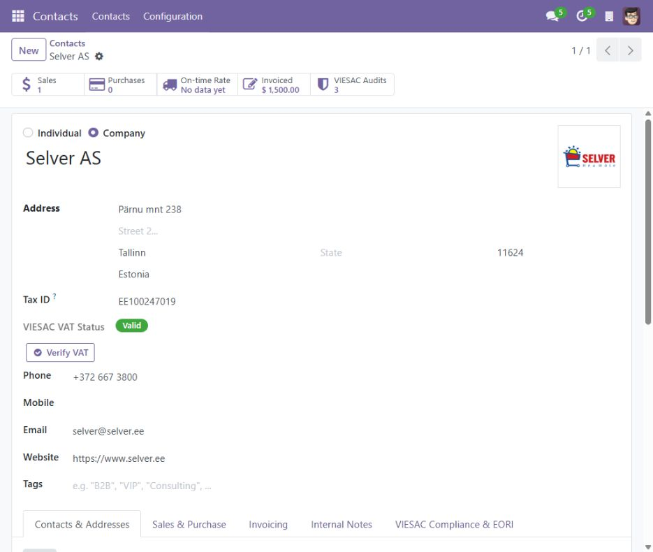
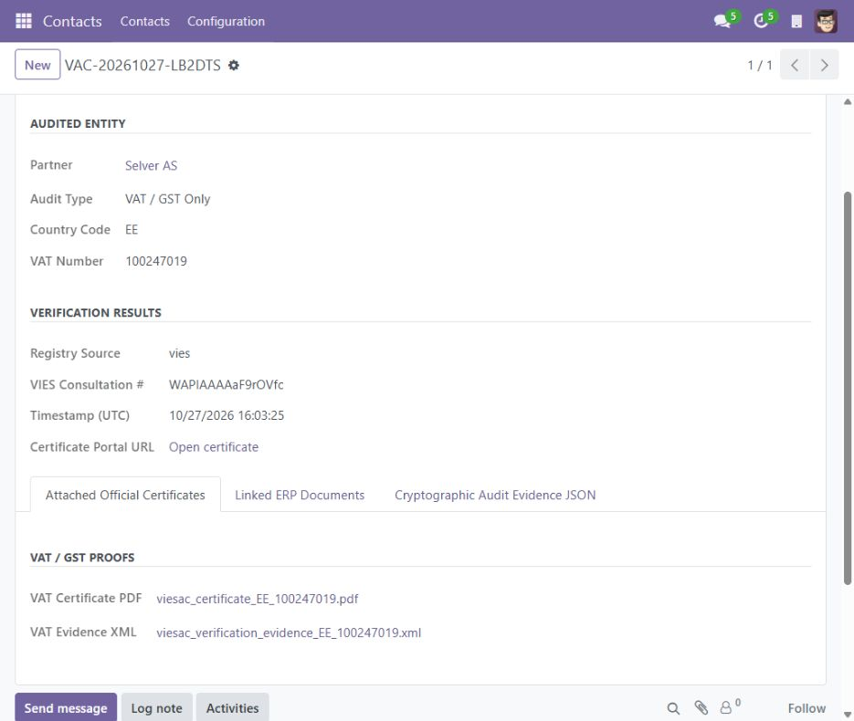
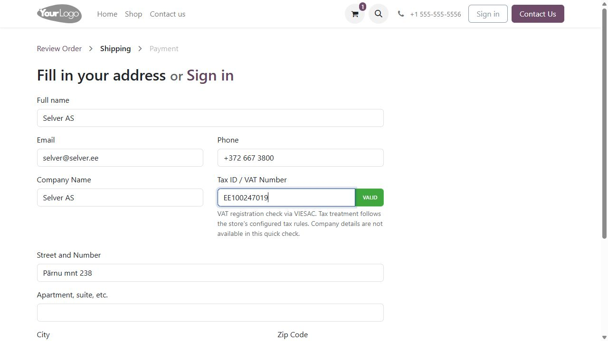

# VIESAC for Odoo 17

VAT/GST and EORI checks, audit records and verification evidence in Odoo, with an optional VAT indicator for eCommerce checkout.

| Module | Purpose |
| --- | --- |
| [`viesac_vat_compliance`](viesac_vat_compliance) | Contacts, sales, purchases, invoices, delivery holds, audit archive and VAT rates catalog. |
| [`viesac_website_sale`](viesac_website_sale) | VAT registration status on the `website_sale` billing address form. Requires the main module. |

Current version: **17.0.1.0.4**. This branch targets Odoo 17.

## Installation

Clone this branch into a directory on your Odoo addons path:

```sh
git clone --branch 17.0 https://github.com/viesac/odoo.git viesac-odoo
```

1. Add the cloned directory to `addons_path` and restart Odoo.
2. Update the Apps list and install **VIESAC: EU VIES VAT, GST & EORI Compliance**.
3. For a web store, also install **VIESAC: eCommerce EU VIES & VAT Checkout**.
4. Open **Accounting → Configuration → Settings → VIESAC**. Enter your API key, save and test the connection.
5. Choose certificate language, automatic attachments, supplier policy and delivery holds.

The main module declares its standard Odoo dependencies, including `base_vat`, Accounting, Sales, Purchase and Sales/Inventory integration. The checkout extension also requires `website_sale`. The `requests` library is included with a standard Odoo installation.

The connector is LGPL-3 and free. Live verification and audits require a [VIESAC account](https://viesac.eu); API limits, audit credits and certificate downloads follow the account plan.

## Native VAT validation

Local Odoo VAT syntax and checksum checks remain enabled through `base_vat`.

- The installation hook disables the company `vat_check_vies` option. Upgrading an older connector to this version applies the same one-time change.
- With an API key and **Use VIESAC for Online VAT Checks** enabled, the connector prevents duplicate native Odoo VIES network calls, including when the company option is subsequently re-enabled.
- `check_vat()` delegates to the standard local validator. It does not use the `no_vat_validation` bypass.
- This Odoo 17 build performs native online validation in separate IAP methods; those actual network entry points are guarded as well.
- Without an API key, or when replacement is disabled, the native method chain is preserved. Enable the standard company online option separately if you want Odoo's native online verification.

Live VIESAC checks run through **Verify VAT**, the checkout indicator and document audits. A global VAT result does not automatically set Odoo's intra-community-valid flag or grant a tax exemption.

## Audit workflow

- Create VAT, EORI or combined audits from contacts and supported business documents.
- Archive available PDF certificates and SHA-256 XML evidence alongside the audit and related document. Certificate language selection covers the 23 VIESAC API locales.
- Stable per-document idempotency keys help prevent duplicate audit creation after a timeout or transaction retry. Manual contact audits intentionally request fresh checks.
- Invoices display their linked audit evidence, rather than a contact's later verification result.
- Editing a contact's VAT/EORI resets the corresponding result. Audit access follows allowed companies; shared contacts retain a shared verification status.

One VIESAC API account is shared by the Odoo database. API and webhook secrets are restricted to system administrators.

## Scheduler and optional webhooks

Odoo's built-in scheduler runs the two module jobs automatically while the server runs:

- Open/pending audits: every **10 minutes**.
- VAT rates catalog: **daily**.

No additional operating-system cron is required.

For optional webhooks, configure a public HTTPS URL ending in `/viesac/webhook` and the same secret in Odoo and the VIESAC portal. The endpoint verifies VIESAC's timestamped HMAC signature and refetches the authoritative audit state. Unsigned requests, expired signatures and requests without a configured secret are rejected. Polling remains available without webhooks.

## eCommerce behavior

The optional checkout extension displays **VALID**, **INVALID**, **PENDING** or **UNVERIFIED** beside the Tax ID field for an active cart. Recent conclusive results use a session cache; temporary errors are not cached as verification results.

Quick checks do not create audit certificates or return company names and addresses. Tax treatment follows the store's configured fiscal positions and accounting localization. The status request does not modify the fiscal position or automatically apply 0% VAT. EORI verification remains in the back office.

## Presentation

The original feature covers are retained as the first manifest images. Descriptions use inline styles, explicit spacing between blocks and centered screenshots limited to 720 px without upscaling.

## Screenshots

These images were captured from a running local Odoo 17 demo. Company details and the logo belong to [Selver AS](https://www.selver.ee/), with public registration data from the [Estonian e-Business Register](https://ariregister.rik.ee/eng/company/10379733/Selver-AS). Transactions are demonstration examples; no customer relationship or endorsement is implied.

### Company card



### Audit and evidence



### eCommerce checkout



The two `static/description/index.html` pages contain inline styles and local outline icons, with additional invoice and sales-order screenshots.

## Verification

**37 connector tests passed** in an isolated Odoo 17 database. Coverage includes company access, local VAT validation, suppression of native network calls, fallback without a key, webhook signatures and HTTP responses, delivery holds, invoice evidence, attachment retries, checkout caching and API-error recovery. External paid audit operations are mocked in the automated suite.

Use a dedicated test database and your normal PostgreSQL configuration:

```sh
odoo -d viesac_connector_test \
  -i viesac_vat_compliance,viesac_website_sale \
  --without-demo=all --test-enable \
  --test-tags=/viesac_vat_compliance,/viesac_website_sale \
  --http-port=8079 --max-cron-threads=0 --stop-after-init
```

## Scope

- Tax exemptions, OSS reporting, fiscal-position mappings and product tax defaults require the appropriate Odoo accounting localization.
- Bulk checks are synchronous; use small selections.
- Certificate download access can differ from audit creation access. Refreshing an audit can retry missing attachments.
- Certificate locale selection covers 23 API locales; translations of all interface labels are not yet complete.
- A SHA-256 evidence hash is not a digital signature. Verification records do not guarantee a tax audit outcome.

## License

[GNU LGPL version 3](LICENSE). Third-party logos and company names remain the property of their respective owners.
